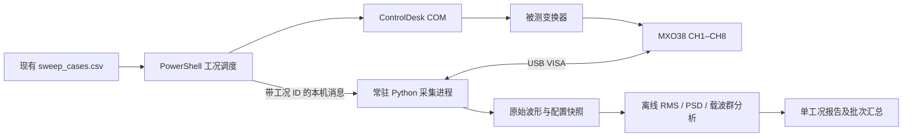

# MXO38 + ControlDesk 自动波形测试台架设计

状态：2026-09-18 原始设计稿。实际脚本入口及已实现范围见同目录 `README.md`；运行配置为 `bench_config.json`，旧 example 仅保留设计参考。实现采用每工况工作进程与本地文件消息，通道可选，不再强制八通道全开。

## 1. 已确认的边界

- 工位：work-pc；现有 ControlDesk 项目 Project_PACC / Experiment_PACC，脚本位于 `F:\ZYS_HYBASE\automation`。
- 仪器：Rohde&Schwarz MXO38，序列号 `1335.2050k08/101400`，固件 `2.8.2.0`。
- VISA：`USB0::0x0AAD::0x0197::1335.2050k08-101400::INSTR`，用户已验证 `*IDN?`。
- CH1 为直流电流，示波器已经显示 A；探头量程上限 30 A，标称 0.1 V/A。探头型号、实际带宽、零偏及标定误差尚未提供。
- 载波群分析采用 q=5，默认 fsw=10000 Hz、f0=50 Hz；统计中心及两侧边带，不以最高谱峰代替群能量。
- 接入现有分 VL 批测；电源仍按每个 VL 组手调。用户允许每个工况使能 10–15 s，本方案默认 12 s。
- CH2–CH8 的物理信号、单位、探头及极性待填写。不得根据通道号推断接线。

本设计中的采样率、分析带宽、稳态阈值是待联调的建议值，不是已测仪器能力或精度保证。`bench_config.example.json` 是未来实现的配置契约，现有脚本不会自动读取它。

## 2. 系统组成与职责



PowerShell 保持硬件使能及异常关断的所有权；常驻 Python 进程独占 VISA 会话。后处理在 Enable1=0 后运行，原始数据允许脱离仪器重复分析。软件主机计时与 COM 调用不是硬实时保护，已有硬件保护仍承担主机失效时的关断。

现有 `sweep_core.ps1::Invoke-SweepCase` 已有 Duration 参数，默认 3；`run_parameter_sweep.ps1` 的计划表也硬编码 3。实现时应将统一配置传到两处及四个 VL 启动入口，避免显示 12 s、实际仍运行 3 s。

## 3. 每个工况的执行时序

| 阶段 | 相对使能时间 | 动作与完成条件 |
| --- | --- | --- |
| 准备 | Enable1=0 | 分配唯一 run/case/capture ID；检查 VISA、容量、八通道、当前无未导出采集；写入并回读 ξ、ud_ref6/7、φ；准备采集设置但不启动 |
| 启动 | t=0 | 先启动原有两路 MF4 录波器，再 Enable1=1；主机单调时钟开始计时 |
| 收敛 | t=0–6 s | 保持原有在线及录波状态检查；不把通信正常当作稳态证明 |
| 采集 | 约 t=6 s | 非阻塞提交一次单次采集请求；目标有效记录 0.5 s，采集完成后保持停止状态 |
| 确认 | t<8.5 s | 工作者返回 acquisition_complete，确认记录已冻结；未完成、失联或触发超时则报错并进入关断 |
| 关断 | 正常约 t=12 s | Enable1=0 并回读；随后停止 MF4。采集失败可提前关断，绝不因等待下载延长使能 |
| 导出 | 关断后 | 顺序导出 CH1–CH8 同一次冻结记录；保存、校验，再离线分析 |
| 下一工况 | 导出通过且关闭≥1 s | 释放本工况；不允许下一次采集覆盖尚未成功落盘的记录 |

10–15 s 都使用同一时序，校验 `settle + acquisition_timeout + shutdown_margin < enable_duration`。12 s 默认保留 3.5 s 余量。所谓“6 s 收敛”只是初始等待预算；波形内稳态检查不通过则该工况标记 nonstationary，不自动加时或重试使能。

单次采集必须明确触发方式、预触发比例、采集次数=1。稳态采集无须与载波相位锁定；默认将预触发设为 0 或验证全部分析区间位于等待完成之后。不能将等待触发当作采集完成，也不能靠固定 sleep 推断完成。

示波器八通道的共同采集时间轴与 MF4 的平台时间轴不是同一个时钟。工况 ID 能关联记录，但不能宣称样点同步。需要瞬时跨设备对齐时，另接共享触发/标记信号并记录其时间戳。

## 4. 调度接口与异常处理

推荐常驻工作进程使用本机 named pipe，传 JSON 请求；响应含 `request_id/run_id/case_id/capture_id`，失败返回明确代码。每个请求按 ID 去重，采集启动超时后不得自动重发并产生第二条记录。

| 接口 | 在主流程中的位置 | 返回内容/约束 |
| --- | --- | --- |
| `prepare` | Enable1=0，参数回读后 | 验证身份/设置/空间；保存 case 配置与参数回读；状态 PREPARED |
| `acquire_async` | 使能后约 6 s | 立即确认接收；独立线程/进程等待示波器采集完成；不下载波形 |
| `poll` | 现有约 10 ms 主循环 | 非阻塞检查共享状态或已到达的响应；主线程不得执行阻塞 VISA/pipe Read |
| `export` | Enable1=0，MF4 停止后 | 读取冻结记录，校验并提交文件；可能耗时数十秒，不占使能预算 |
| `abort` | 异常清理 | 请求示波器停止，保留部分文件与错误；PowerShell 先执行 Enable1=0，再等待采集清理 |
| `close` | 批次结束 | 释放 VISA；保留示波器停止状态，原设置快照可供显式恢复 |

建议在现有 Rig 中增加 `ScopePrepare/ScopeBegin/ScopePoll/ScopeExport/ScopeAbort`，通过可选 Scope 对象接入。先实现不接硬件的调度测试，再接入实际 RsMxo/PyVISA 适配器。禁止在使能循环中直接 `scope.query('*OPC?')` 或调用一个等待下载结束的 Python 子进程。

状态机：`PREPARED -> ACQUIRING -> FROZEN -> EXPORTING -> COMPLETE`；任何阶段可进入 FAILED。COMPLETE 必须同时满足八通道落盘及元数据完整。导出失败保留 frozen 状态，允许在不重新使能、不重新采集的前提下重新导出；后处理失败仅重跑后处理。

原 `case.json` 继续保存 ControlDesk 信息，新增 `scope` 引用及独立 `capture_status`、`analysis_status`、`quality_status`。原始导出完整但稳态/带宽不合格，不能被一个笼统 complete 当作可用于论文比较的合格测量。

## 5. 示波器设置及数据传输

首选普通 Sample、单次采集、DC 耦合、固定通道量程及固定带宽。工况间保持相同配置；避免自动量程、波形平均、包络及 Peak Detect 参与主结果。需要高分辨率或数字滤波时另设固定测量 profile，记录响应和实际有效带宽。

R&S 官方接口候选：

```text
*IDN?
FORMat REAL,32
FORMat:BORDer LSBFirst
RUNSingle
CHANnel1:DATA:HEADer?
CHANnel1:DATA:VALues?
... CHANnel8 ...
```

`RUNSingle` 执行配置的采集次数，不能仅凭命令名字认为次数必然为 1。完成同步可采用官方 RsMxo `run.single_and_wait()` 或经固件核验的 OPC 机制，放在工作进程中并设置上限。实际命令设置须读回并检查仪器错误队列；不得发 `*RST` 作为连接步骤。

官方文档明确 REAL 返回 V/A 物理量，因此 CH1 不再乘 10。保存探头 0.1 V/A 的元数据，并在首次联调对照示波器数值确认；若导出单位实际为 V，则拒绝当作 A 分析，纠正设置后再采集。

二进制采用 IEEE definite-length block；REAL32 payload 为每值 4 字节，LSBFirst 对应 little-endian float32。使用 PyVISA 的二进制块解析或官方驱动，不用文本 split 或删除“固定几个头字节”。二进制读取不能以数据中的换行字节截断；块尾终止符行为按真实设备核验。

每通道读取 header，校验有效 N、Xstart/Xstop、每样点值数、实际返回长度及非有限值。`Vals_Per_Smp=2` 是峰值检测/包络，拒绝进入普通 FFT。NaN/overrange 不插值、不置零。

时间轴保存 `t0, dt, N`。官方当前 header 描述 Xstop 为末样点时间，可候选计算 `dt=(Xstop-Xstart)/(N-1)`，但首次必须用仪器采样间隔/实际采样率交叉核实固件 2.8.2.0 的端点语义；不能盲目除 N，也不能只用面板时基推算。八通道分别保存时间轴并核对，不一致则禁止合并为同步矩阵。

以上文档当前版本为 2.10；用户设备是 2.8.2.0。逐通道接口作为第一版候选，高速多波形 `EXPort:WAVeform:DATA` 等优化须待兼容性确认后再启用。

## 6. 采样、带宽与容量

建议分析记录长度 0.5 s：50 Hz 下覆盖 25 个周期，完整记录频率格距 2 Hz。Welch 子窗建议 0.1 s、50% 重叠，格距 10 Hz、Hann 等效噪声带宽约 15 Hz，0.5 s 记录共 9 个重叠子窗。

建议目标存储率 5 MSa/s，则每通道约 250 万点，八通道 float32 原始样值约 80 MB/次，15 个工况约 1.2 GB，未计频谱/MF4/重复测量。**此数是条件性容量估算，不能直接把示波器采样率降到 5 MSa/s 并宣称没有混叠。**

必须先查探头带宽、示波器开启八通道后的实际采样率/存储深度和降采样方式。若模拟链仍允许远高于 2.5 MHz 的开关尖峰通过，5 MSa/s Sample 会有混叠风险。合法路线为：

1. 模拟带宽与采样率配套，并验证 Nyquist 外的抑制；或
2. 保持足够高的原始采样率，确认仪器导出前有合格抗混叠滤波；或
3. 获取高率原始记录，PC 上用已定义低通滤波器后再降采样，保留高率原始文件。

第三种路线的容量按高率数据算，例如 100 MSa/s、0.5 s、8 通道、float32 为 1.6 GB/次。若设备内存不支持，应调整记录方案并重新规定频率分辨率，不能默默导出屏幕抽点代替原始数据。采集及存储率 profile 在所有比较工况中固定。

无需刻意让采样率与 10 kHz 非整数倍。足够高、均匀且抗混叠的采样完全可以取整数倍；此前 10 kHz 控制日志的问题是记录率不足，无法观察 10/20 kHz 群。

## 7. CH1 计算定义

将原始物理量转 float64 计算，原始样值保持原样。若存在独立零电流标定 b，则 i[n]=i_raw[n]-b，并保存 b、时间与标定条件；没有标定就不猜零偏。去均值的 AC 纹波不受常数零偏影响，但总 RMS 与 DC 会受影响。30 A 是探头量程信息，不是允许自动增加的实验电流。

### 7.1 时域指标

对固定稳态窗口内的 N 个等间隔样点：

$$I_{DC}=\frac{1}{N}\sum i[n],\quad I_{RMS}=\sqrt{\frac{1}{N}\sum i[n]^2}$$

$$I_{AC}=\sqrt{\frac{1}{N}\sum(i[n]-I_{DC})^2},\quad I_{RMS}^2=I_{DC}^2+I_{AC}^2.$$

不加 Hann 窗计算时域 RMS；不先 detrend 掉缓慢变化；采样标准差使用总体口径 ddof=0。额外输出峰峰值、正负峰值及纹波系数 I_AC/|I_DC|，均值接近零时纹波系数返回 undefined。

分别命名 `rms_ac_acquisition_band_A` 和 `rms_ac_100k_A`。前者包含整个实际采集链的有效带宽，后者是建议 100 kHz 低通下的结果；100 kHz 是候选规范值，须由探头能力及研究目标确认。不能将二者都简称“总纹波”。滤波版本记录滤波器系数/响应、边缘舍弃区间及剩余样点数；没有抗混叠有效性证据时不能用后置滤波修复。

### 7.2 FFT / PSD

绘图与能量采用不同归一化。令 x=i-I_DC，周期 Hann 窗 w，X=rFFT(w*x)，U=sum(w²)，频率格距 Δf=fs/N。

$$S[k]=\frac{|X[k]|^2}{f_s U}\,c_k,$$

其中单边谱内部频点 c_k=2，DC 及偶数 N 的 Nyquist 点 c_k=1。单位 A²/Hz。Welch 对每个子窗按此归一化后平均，不额外重复扣掉每个子窗的均值；否则低频能量口径会改变。

群均方值 `M_B = sum(S[k] * bin_overlap_hz[k,B])`，群 RMS 为 sqrt(M_B)。明确频率 bin 边界及部分覆盖规则；完整频域总量核验使用 sum(S)*Δf。不要直接求频谱幅值和，也不要将 PSD 积分后再除以 2。Hann 谱的 Parseval 对象是 `sum(w²*x²)/sum(w²)`，不应强迫其与未加窗时域 I_AC² 逐点相等。

FFT 幅度展示可用 A_peak[k]=2|X[k]|/sum(w)（内部频点），其准确幅值解释限于孤立且相干的谱线；非相干谱峰有 scalloping loss。因此最优相位的排序使用群 PSD 积分及同口径 AC RMS。

### 7.3 q=5 的边界约定

理论中心为 `n*fsw + q*f0`，q=-5,...,+5。50 Hz 下：

| 结果 | 第一群 Hz | 第二群 Hz | 用途 |
| --- | --- | --- | --- |
| strict_q5_span | [9750,10250] | [19750,20250] | 严格“中心 ±250 Hz”频带，便于复核，但边缘谱线会受截断 |
| q5_group | [9725,10275] | [19725,20275] | 以相邻边带中点为边界，包含 q=±5 谱线的展宽，作为主群能量指标 |

q5_group 的 ±275 Hz 不是增加 q=±6，而是给最外侧 q=±5 各留半个 f0 的积分空间。Hann 主瓣到首零点约 ±2Δf；0.1 s 子窗下约 ±20 Hz，尚小于 25 Hz。窗函数仍有旁瓣，因此这只是清晰可复现的组间划分，不是绝对无泄漏分离。

同时输出完整记录 periodogram 群能量与 Welch 群能量；主比较采用固定 Welch 配置，完整记录作为敏感性核查。若中心/基波有漂移，报告名义频率与实测偏移，并检查群外泄漏；基于独立参考重新确定中心须在整组统一采用，不能逐工况追峰改变积分带以获得更好的结果。

连续频带积分包含噪声及群内非整数边带，不能直接声称等于模型中 11 条理想离散谱线的平方和。需要模型逐 q 对照时另做参考频率锁定的正弦拟合/解调，保留它与群 PSD 能量之间的差额。

### 7.4 “纹波能量”的单位

- `M10_A2`、`M20_A2`：两群均方值 A²，作为工况比较的首要量。
- `I10_A`、`I20_A`：各群 RMS，单位 A。
- `I10_20_A = sqrt(M10+M20)`：两群合成 RMS，不是 I10+I20。
- `J10_20_A2s = T*(M10+M20)`：由频谱估计得到的记录时段二次量指标，单位 A²·s，不称电能 J。
- 若要电阻耗散能量需 R 与有效电流定义；若要实际端口能量需同步 v(t)、i(t)。仅 CH1 无法给出该端口真实电能。

报告同时给 `M10/M20`（分母接近噪声底时不稳定）及 `sqrt(M10/M20)`。从已经相移后的实测波形得到的比值不能自动当作零相位预测模型的 Gamma。

## 8. 质量检查与精度边界

硬性失败：身份不符、CH1 单位不为 A、请求通道未采集、二值包络、样点不足、无效数、明确 overrange、时间轴错误、未完成的新采集、文件不完整。不得用上一工况的缓存填补缺失通道。

质量标记：疑似 ADC/探头饱和、模拟带宽或抗混叠未知、幅度靠近量程、非稳态、边带超出固定频带、零偏未标定。ADC 是否削顶应结合仪器量程/overrange 状态；“样值没超过30A”不足以证明无饱和。

稳态诊断将 0.5 s 分成五个不重叠 0.1 s 块，比较 DC、AC RMS、两群均方值及线性趋势。建议初始阈值：块 DC 最大变化不超过 max(0.02A,2%|DC|)，AC RMS 块间跨度不超过均值的5%；均方值接近噪声底时另设绝对阈值。阈值须结合探头噪声标定。该检查只能发现记录内变化，不能证明前6秒已充分收敛。

9 个重叠 Welch 窗不是9个独立实验，不能直接据此做独立样本 t 检验或给出重复实验置信区间。正式比较建议每工况至少3次独立采集；重复次数默认仍为1，是否增加由实验计划决定。原始与噪声底修正结果分开保存，默认不扣噪声。

“精确 RMS”包括算法口径正确和测量链准确两层。算法可以用 Parseval/已知信号核验；绝对精度还受探头增益、零偏、带宽、ADC量程和量化误差影响。30 A/0.1 V/A 不能推出一个可信的误差百分比。

## 9. 八通道文件组织

```text
sweep_results/VL_120/run_<UTC时间>_<随机ID>/
  plan.csv
  bench_config.json
  summary.csv
  case_01_phi_118/
    case.json
    xi_0.8+84.9_84.9+meas1abc.mf4
    xi_0.8+84.9_84.9+meas2abc.mf4
    scope/capture_<ID>/
      instrument.json
      settings.json
      channels.json
      waveforms.h5
      manifest.json
      acquisition.log.jsonl
      analysis/<算法版本>_<配置hash>/
        metrics.json
        spectrum.h5
        ch1_time.png
        ch1_psd.png
        ch1_carrier_groups.png
```

HDF5 按 `/channels/CH1/samples` 至 `/channels/CH8/samples` 分开保存原始 REAL32 物理量。每通道属性包括 physical_signal、unit、t0_s、dt_s、N、原始 header、probe/ratio/zero_offset、vertical_scale/offset、coupling、bandwidth、deskew 和配置来源。共享时间轴仅在逐通道核验后使用；不重复写八份巨大 time 数组。

元数据保存 IDN/固件、实际采样率和长度、仪器设置回读、触发/采集模式、日期时区、工况请求及回读值、使能及采集事件的主机单调时间和墙钟时间、算法/依赖版本。VL 标签标为 manual_setpoint，不伪装成实测母线电压。

每个通道先写到 `.partial` HDF5，逐块处理大数组，完成后 flush/close，重新打开校验 dtype/shape/属性与样值有效性，计算 SHA-256，原子更名为正式文件，最后提交 manifest 的 COMPLETE 状态。原始文件提交后不被后处理修改，重分析使用新的版本目录。实现时还需做磁盘空间预检和批次级单写者锁。

CSV 仅保存汇总和按需指定片段的样值，截图仅辅助查看；不以截图或屏幕抽点 CSV 替代原始波形。CH2–CH8 默认全部保存、逐通道计算基础 DC/RMS/峰值；只有已配置单位与信号含义的通道才进行专用物理分析。

`summary.csv` 一行一个 capture，包含 case_id、VL标签、ξ/φ/ud_ref回读、窗口/带宽、DC/总RMS/AC RMS、M10/M20、I10/I20、两群RSS、strict频带结果、quality_status和原始文件路径。分析版本变化时重建汇总，不重复累加旧行。

## 10. 实施与验收顺序

1. **只读联调**：读取身份、CH1单位/探头、八通道启用情况、采样/存储能力、当前波形头与设置；与固件2.8.2.0命令集核对。只读探测不能顺手清空设置/切换采集。
2. **离线算法测试**：已知DC+10/20kHz及q=±5边带，验证RMS平方关系、PSD Parseval、奇偶N/DC/Nyquist归一化；非相干频率、q边界、噪声、漂移、削顶和缺样拒绝路径。它们是软件测试，不冒充物理实验结果。
3. **单工况采集联调**：验证一次新采集完成、八通道同记录、单位与面板数值一致，关断后下载，重新读取HDF5复算一致。
4. **时序故障测试**：VISA/触发超时、工作进程退出、导出失败/磁盘满、COM失败，验证关断优先、部分文件不变成成功、下一工况不启动。覆盖现有MF4回归测试。
5. **分VL批次**：从一个工况开始，验证总时长/工况关联后扩展到现有15点。预测最优角若要与90/180度比较，须在同一VL、ξ和参考幅值下增加对照行，不能跨工作点排序；本设计不擅自扩充现有实验表。

当前仍需在首次联调补齐：探头型号/有效带宽、CH2–CH8接线表、固件兼容性、实际八通道采样深度/传输耗时、噪声底和零偏。以上缺项不影响架构与分析定义，但决定最终可用采样profile和精度声明。

## 官方依据

- [MXO 3 User Manual](https://www.rohde-schwarz.com/uk/manual/rs-mxo-3-user-manual_78701-1591401.html)：当前列表版本07，FW2.10，2026-07-10。
- [RsMxo Run](https://rsmxo.readthedocs.io/en/latest/Run.html)：RUNSingle与采集完成同步。
- [RsMxo Format Data](https://rsmxo.readthedocs.io/en/latest/FormatPy_Data.html)：REAL32/64及V/A物理量。
- [RsMxo Format](https://rsmxo.readthedocs.io/en/latest/FormatPy.html)：二进制字节序。
- [RsMxo Channel Header](https://rsmxo.readthedocs.io/en/latest/Channel_Data_Header.html)：时间轴、点数及每样点值数。
- [RsMxo Examples](https://rsmxo.readthedocs.io/en/latest/examples.html)：完成一次采集后顺序导出多通道。
